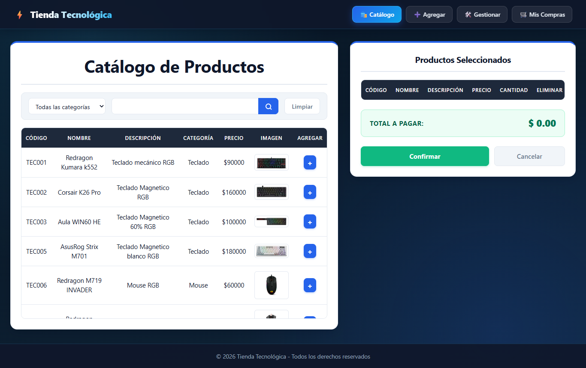
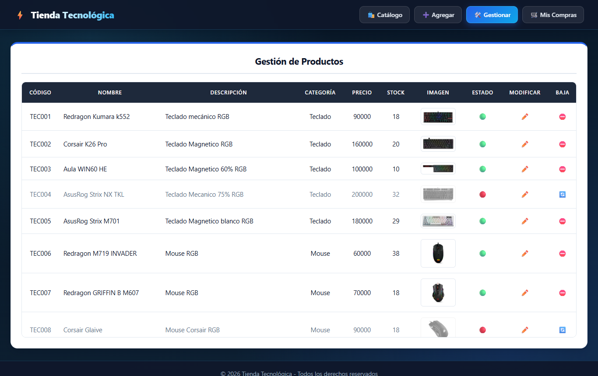
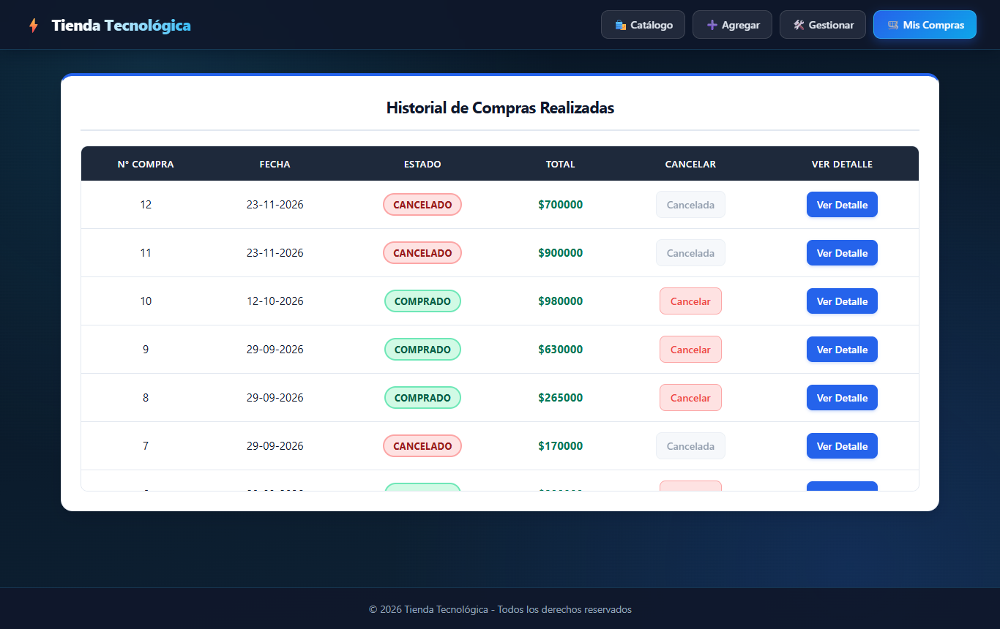
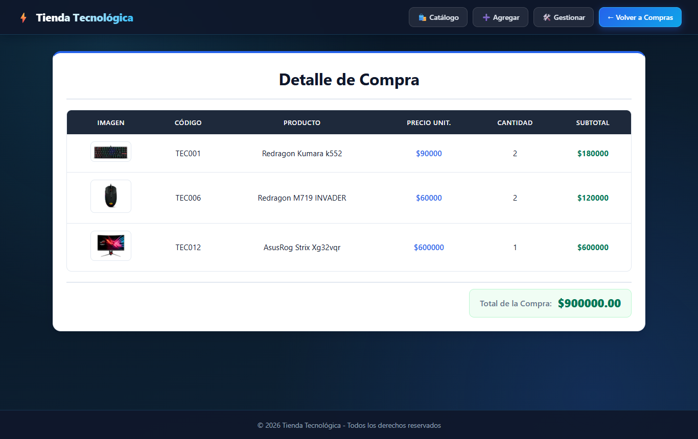
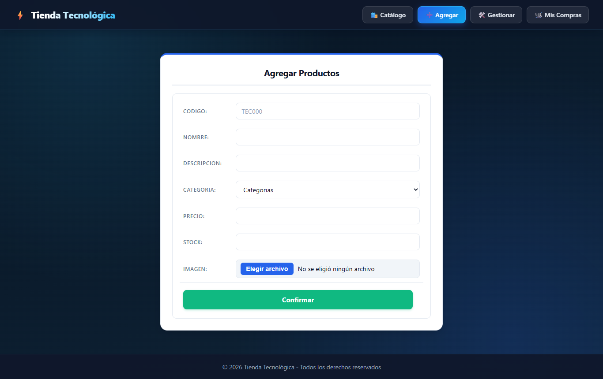
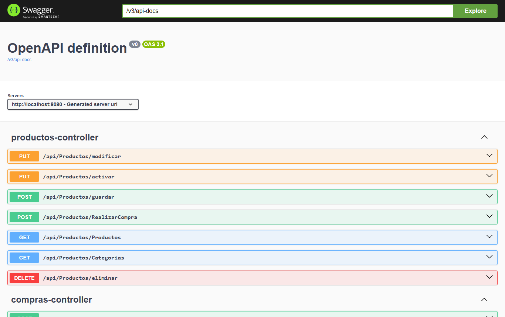
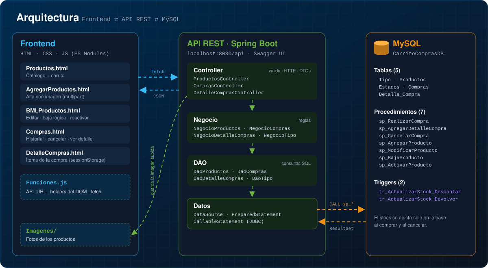
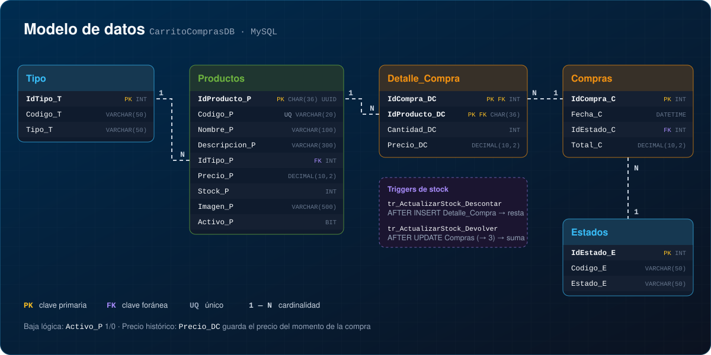

<div align="center">

# 🛒 Tienda Tecnológica 2.0

**E-commerce de práctica con API REST en Java (Spring Boot) y MySQL.**
Catálogo con carrito, alta y gestión de productos, historial de compras con cancelación y stock que se ajusta solo desde la base de datos.


</div>

> Es la versión en Java de mi [Tienda Tecnológica en C# / ASP.NET Core](https://github.com/JoseZenteno269/Tienda_Tecnologica). La rehíce desde cero para aprender el ecosistema Java manteniendo la misma idea: **API en capas, SQL a mano y frontend sin frameworks.**

---

## 📸 Capturas

| Catálogo y carrito | Gestión de productos |
| :---: | :---: |
|  |  |

| Historial de compras | Detalle de compra |
| :---: | :---: |
|  |  |

| Alta de producto | API documentada con Swagger |
| :---: | :---: |
|  |  |

---

## 📑 Contenido

- [Funcionalidades](#-funcionalidades)
- [Arquitectura](#-arquitectura)
- [Flujo de compra y cancelación](#-flujo-de-compra-y-cancelación)
- [Base de datos](#-base-de-datos)
- [API REST](#-api-rest)
- [Estructura del proyecto](#-estructura-del-proyecto)
- [Cómo ejecutarlo](#-cómo-ejecutarlo)
- [Qué aprendí y próximos pasos](#-qué-aprendí-y-próximos-pasos)

---

## ✨ Funcionalidades

### 🛍️ Catálogo y carrito · `Productos.html`
- Muestra solo los productos **activos**.
- Filtro por **categoría** y búsqueda por **nombre o código**.
- Carrito con control de cantidades, total en tiempo real y prevención de productos repetidos.
- Antes de confirmar, la API **valida el stock** de cada ítem. Al confirmar, el stock se descuenta solo con un trigger.

### ➕ Alta de productos · `AgregarProductos.html`
- Formulario con código, nombre, descripción, categoría, precio, stock e **imagen** (`multipart/form-data`).
- No permite códigos duplicados, y la imagen se guarda en `frontend/Imagenes/`.

### 🛠️ Gestión de productos · `BMLProductos.html`
- **Edición en línea** de nombre, descripción, categoría (arranca en la actual), precio y stock.
- **Baja lógica** (`Activo_P = 0`) y **reactivación** (`Activo_P = 1`), con confirmación en la misma fila.
- La API responde con el código HTTP que corresponde: `404` si el producto no existe y `409` si ya estaba dado de baja o activo.

### 🧾 Historial y detalle · `Compras.html` y `DetalleCompras.html`
- Compras ordenadas por fecha, con **badge de estado** (Comprado / Cancelado).
- **Cancelar una compra devuelve el stock** automáticamente, con un trigger. Una compra cancelada no se puede volver a cancelar: lo controla el botón y también el procedimiento en la base.
- El detalle muestra el **precio histórico** (`Precio_DC`, el precio del momento de la compra), la cantidad y el subtotal. La compra elegida pasa de una página a otra con `sessionStorage`.

---

## 🏗️ Arquitectura

<p align="center">
  
</p>

| Capa | Qué hace | Clases |
|---|---|---|
| **Frontend** | 5 páginas HTML con un JS por vista (ES Modules). `Funciones.js` centraliza `API_URL` y los helpers para armar tablas, mensajes y selects. | `Producto.js`, `Compras.js`, `BMLProductos.js`… |
| **Controller** | Recibe el HTTP, valida los datos de entrada y devuelve `ResponseEntity` con el código y el mensaje correctos. | `ProductosController`, `ComprasController`, `DetalleComprasController` |
| **Negocio** | Reglas: existencia, estado activo, armado de entidades. | `NegocioProductos`, `NegocioCompras`, `NegocioDetalleCompras`, `NegocioTipo` |
| **DAO** | Una clase por entidad, con sus consultas SQL y llamadas a procedimientos. | `DaoProductos`, `DaoCompras`, `DaoDetalleCompras`, `DaoTipo` |
| **Datos** | Acceso **JDBC** reutilizable sobre el `DataSource` de Spring: ABM, escalares, `Existe` y ejecución de procedimientos almacenados. | `Datos` |
| **MySQL** | Tablas, 7 procedimientos almacenados y 2 triggers que mantienen el stock consistente. | `CarritoComprasBD.sql` |

---

## 🔄 Flujo de compra y cancelación

<p align="center">
  
</p>

- **Comprar:** el carrito viaja como JSON a `POST /RealizarCompra`. La API valida el stock y, si alcanza, `sp_RealizarCompra` crea la compra y devuelve su `IdCompra`. Después, `sp_AgregarDetalleCompra` inserta cada ítem, y por cada inserción el trigger `tr_ActualizarStock_Descontar` resta el stock.
- **Cancelar:** `POST /cancelar` ejecuta `sp_CancelarCompra`, que pasa la compra al estado `3` (Cancelado) **solo si no lo estaba**. El trigger `tr_ActualizarStock_Devolver` detecta ese cambio y devuelve el stock de cada ítem.

---

## 🗄️ Base de datos

<p align="center">
  
</p>

| Procedimiento / Trigger | Qué hace |
|---|---|
| `sp_RealizarCompra` | Inserta la compra y devuelve `LAST_INSERT_ID()` |
| `sp_AgregarDetalleCompra` | Inserta un ítem del detalle con su cantidad y precio |
| `sp_CancelarCompra` | Pasa la compra a Cancelado (`3`) si todavía no lo estaba |
| `sp_AgregarProducto` | Alta de producto (el `IdProducto_P` es un `UUID()` generado por MySQL) |
| `sp_ModificarProducto` | Actualiza nombre, descripción, categoría, precio y stock |
| `sp_BajaProducto` / `sp_ActivarProducto` | Baja lógica y reactivación (`Activo_P`) |
| `tr_ActualizarStock_Descontar` | `AFTER INSERT ON Detalle_Compra` → resta el stock |
| `tr_ActualizarStock_Devolver` | `AFTER UPDATE ON Compras` → si pasa a Cancelado, devuelve el stock |

El script `CarritoComprasBD.sql` crea todo y carga los datos base: los estados (Comprado, Pendiente, Cancelado) y las categorías iniciales.

---

## 🔌 API REST

Base: `http://localhost:8080/api` · Documentación interactiva: **`http://localhost:8080/swagger-ui/index.html`**

| Método | Ruta | Descripción | Respuestas |
|---|---|---|---|
| `GET` | `/Productos/Productos?texto=&valor=` | Lista productos, filtrando por texto (nombre o código) y por categoría | `200` |
| `GET` | `/Productos/Categorias` | Lista las categorías | `200` |
| `POST` | `/Productos/guardar` | Alta de producto con imagen (`multipart/form-data`) | `200` · `400` · `500` |
| `PUT` | `/Productos/modificar` | Modifica un producto (JSON) | `200` · `400` · `404` · `500` |
| `DELETE` | `/Productos/eliminar?codigo=` | Baja lógica | `200` · `400` · `404` · `409` |
| `PUT` | `/Productos/activar?codigo=` | Reactivación | `200` · `400` · `404` · `409` |
| `POST` | `/Productos/RealizarCompra` | Registra la compra y su detalle (JSON) | `200` · `400` |
| `GET` | `/Compras/Compras` | Historial de compras | `200` |
| `POST` | `/Compras/cancelar` | Cancela una compra (`{ "idCompra": 1 }`) | `200` · `400` |
| `GET` | `/DetalleCompras/VerDetalle/{idCompra}` | Ítems de una compra | `200` |

Todas las respuestas de error vuelven como `{ "mensaje": "..." }` y el frontend las muestra tal cual.

---

## 📁 Estructura del proyecto

```text
Tienda_Tecnologica_2.0/
├── CarritoComprasBD.sql          # Tablas, procedimientos, triggers y datos base
├── .env.example                  # Plantilla de credenciales (copiar como .env)
├── backend/                      # Spring Boot (Maven)
│   └── src/main/java/com/carrito/backend/
│       ├── Controller/           # Endpoints REST
│       ├── Negocio/              # Reglas de negocio
│       ├── DAO/                  # Consultas SQL + Datos.java (JDBC)
│       ├── DTOs/                 # Requests / responses
│       └── Entidades/            # Modelos
├── frontend/
│   ├── *.html                    # Productos, AgregarProductos, BMLProductos, Compras, DetalleCompras
│   ├── Css/                      # Base.css + un archivo por vista
│   ├── Javascript/               # Funciones.js (compartido) + un script por vista
│   └── Imagenes/                 # Fotos de los productos
└── docs/                         # Diagramas SVG y capturas
```

---

## 🚀 Cómo ejecutarlo

**Requisitos:** JDK 26, MySQL, VS Code con Extension Pack for Java y Live Server.

1. **Base de datos:** ejecutá `CarritoComprasBD.sql` en MySQL (crea `CarritoComprasDB`).
2. **Credenciales:** copiá `.env.example` como `.env` en la raíz del proyecto y completá tu usuario y contraseña de MySQL (`DB_USERNAME` y `DB_PASSWORD`). `application.properties` las lee como variables de entorno, y el `.env` está en `.gitignore`, así que no se sube.
3. **Backend:** abrí la carpeta raíz del proyecto en VS Code y ejecutá la configuración **`Spring Boot-BackendApplication<backend>`** (F5). Esa configuración carga el `.env` sola, y el backend queda escuchando en `http://localhost:8080`.
   > ⚠️ Conviene levantarlo así, y no con `mvnw spring-boot:run` desde `backend/`, porque la imagen subida se guarda en una ruta relativa (`frontend/Imagenes`). La configuración de VS Code usa la raíz del proyecto como directorio de trabajo. Si se ejecuta desde `backend/`, las imágenes terminan en `backend/frontend/Imagenes` y el catálogo no las muestra.
4. **Frontend:** abrí `frontend/Productos.html` con **Live Server**. Hace falta un servidor porque los scripts son ES Modules.

---

## 🧠 Qué aprendí y próximos pasos

**Lo que me llevo:**
- Pasar de C# a Java sin cambiar la arquitectura: Controller → Negocio → DAO → Datos.
- Usar JDBC "a mano" (`PreparedStatement`, `CallableStatement`, `ResultSet`) sobre el `DataSource` de Spring.
- Dejar en la base las reglas que tienen que cumplirse siempre, como el stock, con triggers.
- Devolver códigos HTTP con sentido (`400`, `404`, `409`, `500`) y documentar la API con Swagger.
- Sacar las credenciales del código y leerlas desde variables de entorno (`.env`).

**Próximos pasos:**
- [ ] Registrar la compra y su detalle dentro de **una sola transacción**.
- [ ] Sacar la dependencia de JPA, que hoy no se usa, o migrar los DAO a Spring Data JPA para comparar los dos enfoques.
- [ ] Guardar las imágenes en una ruta configurable en lugar de una ruta relativa.

---

<div align="center">

Hecho por **José Zenteno** · [GitHub](https://github.com/JoseZenteno269) · [Portfolio](https://josezenteno.dev) · [LinkedIn](https://linkedin.com/in/jose-zenteno-357813235)

</div>
